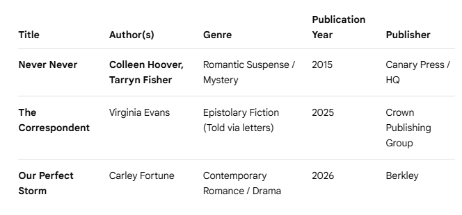

## Task

Select three books on a single subject of your choice. At least one book must have multiple authors. For each book, record the title, authors, and two to three additional attributes of your choosing (e.g., publication year, publisher, ISBN, genre, rating).

Using this information, manually create two data files:

An HTML file containing a table with the book data (e.g., books.html)

A JSON file representing the same data (e.g., books.json)

Unless you are already very comfortable with these formats, you are expected to create both files by hand to better understand their structure.

Next, write R code (using packages of your choice) to:

Load the HTML data into an R data frame

Load the JSON data into a separate R data frame

Compare the two data frames and determine whether they are identical

Deliverables books.html

books.json

R code that loads and compares both data sources

Package your complete solution in a Quarto (.qmd) file and publish it to rpubs.com.

Note: Publishing will require making your HTML and JSON files publicly accessible on the web.

## Approach

I have selected the following three books on the subject of "Contemporary Fiction Novels"

](images/books-table.png)

I'm going to create the books.html and books.json file in visual studio code.

In the books.html file, I will create a table and insert all the data.

In the books.json file, I will create an array objects containing the same information.

I'm going to use rvest package to load an HTML file into R. To load json file into R, I'm going to use jsonlite package.

## Anticipated challenge

This is my first time loading html file and json file into R. So may face challenges in data formats.

## Code

```{r}


library(rvest)
library(jsonlite)


# Provide the path to your local HTML file
local_html <- "D:/Data-607/Week7-html-json/books.html"

# Read and convert exactly the same way
my_data_frame <- read_html(local_html) %>% 
  html_node("table") %>% 
  html_table()

my_data_frame
```
```{r}
json_df<-fromJSON("D:/Data-607/Week7-html-json/books.json")
json_df
```
